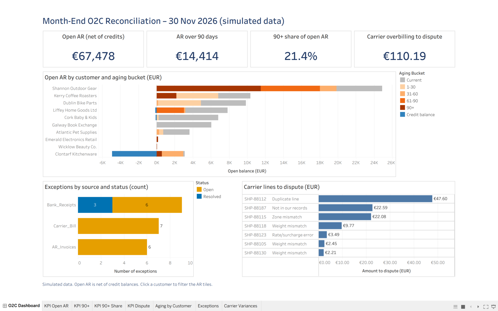
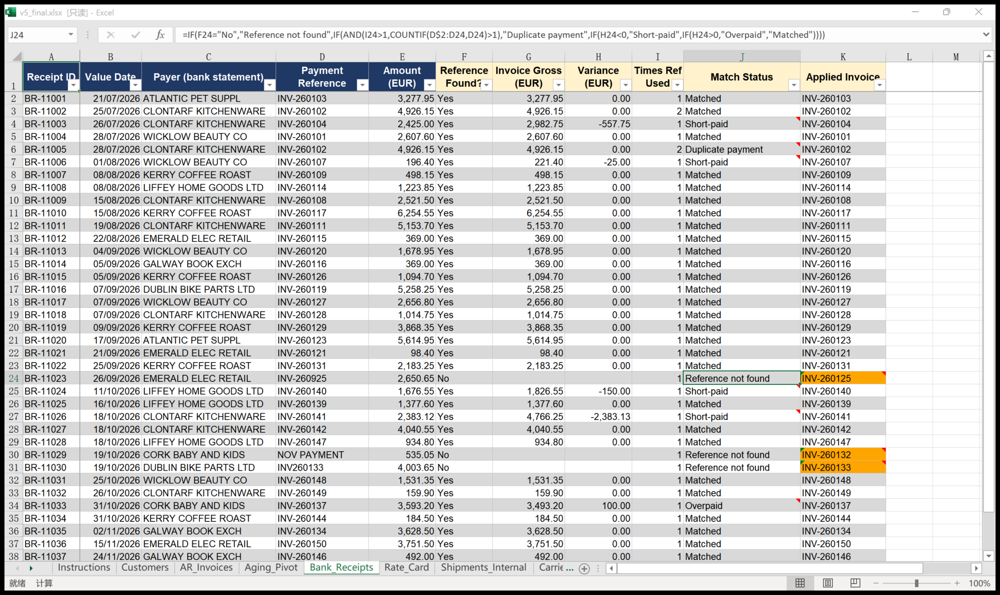
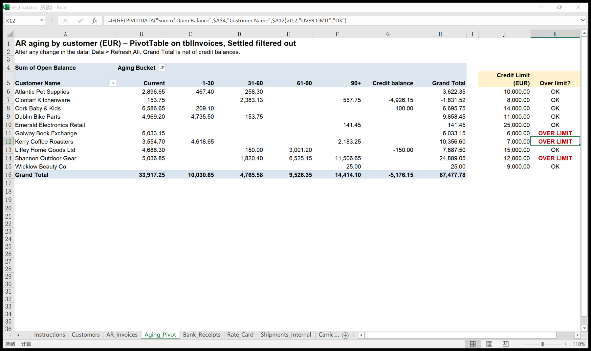
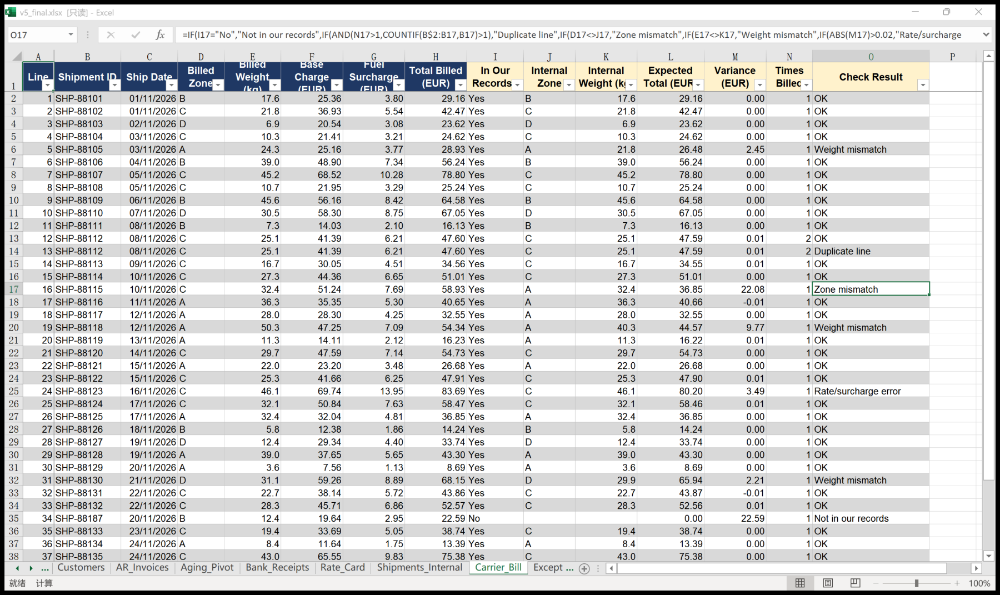

# Month-End Order-to-Cash Reconciliation in Excel & Tableau

A self-directed practice project: a full month-end order-to-cash close for a fictional Irish logistics business, built in Excel and Tableau. It covers matching customer payments to invoices, an accounts receivable (AR) aging report, a carrier bill check, and an exception log with a management summary.

> **Data note:** all data is simulated and contains deliberately planted issues. It is not real company data and is not linked to any real company.

**Tableau dashboard:** https://public.tableau.com/app/profile/xuefei.niu/viz/O2C_Dashboard/O2CDashboard

**Excel workbook (view online, no download):** [Open v5_final.xlsx in Excel Online](https://1drv.ms/x/c/2b3b39805b3e81f5/IQDepyjZOTNdQKEO1V9F0F7MAQgKjm0elCIO45CwA0N9Bhg?e=PzYIRc)



## Business questions

1. Which customer payments match which invoices, and which do not?
2. How much is overdue, by how long, and which customers are a bad-debt risk?
3. Is the carrier billing us correctly against the contracted rate card?
4. What needs action, and how much money is involved?

## Data

| Sheet | Contents |
|---|---|
| Customers | 10 customers with payment terms and credit limits |
| AR_Invoices | 69 invoices and credit notes (Jun–Nov 2026) |
| Bank_Receipts | 39 customer payments from the bank statement |
| Carrier_Bill / Shipments_Internal / Rate_Card | 42 carrier bill lines, 40 internal shipment records, contracted rates |

## Process

| Step | What I did | Excel / Tableau skills |
|---|---|---|
| 1. Lookups | Added customer name, payment terms and due date to every invoice | XLOOKUP, VLOOKUP |
| 2. Cash application | Matched receipts to invoices, classified variances, applied unreferenced receipts manually | MATCH, COUNTIF, nested IF |
| 3. AR aging | Calculated open balances and aging buckets; built an aging PivotTable and a credit-limit check | SUMIFS, PivotTable, GETPIVOTDATA |
| 4. Carrier bill check | Re-priced each bill line from internal weight and zone; flagged duplicates and mismatches | Lookups, COUNTIF, nested IF, €0.02 tolerance |
| 5. Exception log | Logged each issue with amount, root cause, action and status; wrote a formula-driven management summary with control checks | SUMIFS, COUNTIFS, TEXT |
| 6. Dashboard | Built a one-page Tableau dashboard: KPIs, aging by customer, exceptions, carrier variances | Tableau extracts, calculated fields, dashboard filter action |

Lookups are written as `IFERROR(XLOOKUP(...), VLOOKUP(...))` so the workbook calculates in both Microsoft 365 and older Excel versions.

### Cash application – match status per receipt


### AR aging PivotTable with credit-limit check


### Carrier bill check


A dated record of each step, including problems hit and how they were solved, is in the `Process_Log` sheet of `excel/v5_final.xlsx`.

## Results

| Metric | Result |
|---|---|
| Receipts matched by exact reference | 30 of 39 (36 references found; 6 had a variance or were a duplicate) |
| Unreferenced receipts applied manually | 3 (€7,189.35) |
| Exceptions logged (resolved / open) | 22 (3 / 19) |
| AR over 90 days | €14,414.10 (21.4% of net open AR of €67,477.78) |
| Highest bad-debt risk | Shannon Outdoor Gear – €11,506.65 over 90 days, €24,889.05 owed against a €12,000 limit, no payments received |
| Carrier overbilling to dispute | €110.19 across 7 lines |

## Key finding

Dublin Bike Parts paid €4,003.65 with the reference "INV260133" (the hyphen was missing), so an exact lookup could not find the invoice. Before that receipt was applied, the customer appeared to owe €13,862.10 against an €11,000 credit limit, so it would have been flagged as over limit and could have been chased or put on hold. After matching the payment by payer name and exact amount, the balance is €9,858.45 and the customer is within its limit. Unapplied cash makes good customers look risky, so it has to be cleared before collections and credit decisions are made.

## What I would improve next

- Require the invoice number on every remittance, and validate references on receipt (for example, flag any reference that does not match the `INV-######` format) so that unapplied cash is caught the same day.
- Agree a written tolerance policy for small short payments such as bank charges, so they can be written off consistently instead of being chased one by one.

## How this was built

Built with AI assistance (Claude Code): it drafted formulas, the exception log and the Tableau workbook, and I reviewed the results and published the dashboard. The `Process_Log` sheet records which parts were AI-assisted.

## Folder structure

```
data/          original practice workbook (data unchanged)
excel/         v1_lookups → v5_final, one version per step
screenshots/   key screenshots, formula bar visible
tableau/       .twbx file (data extracts)
```
